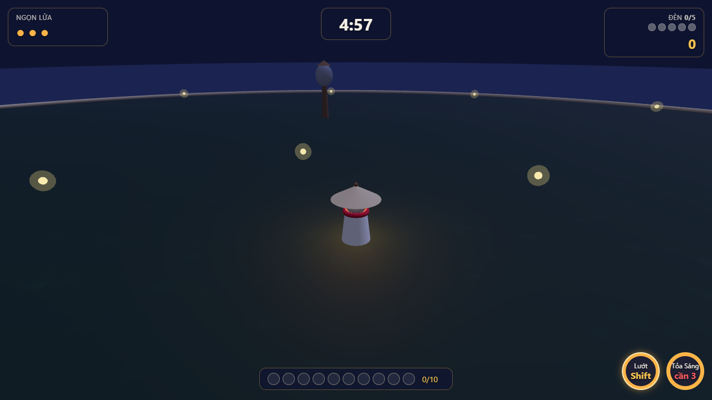
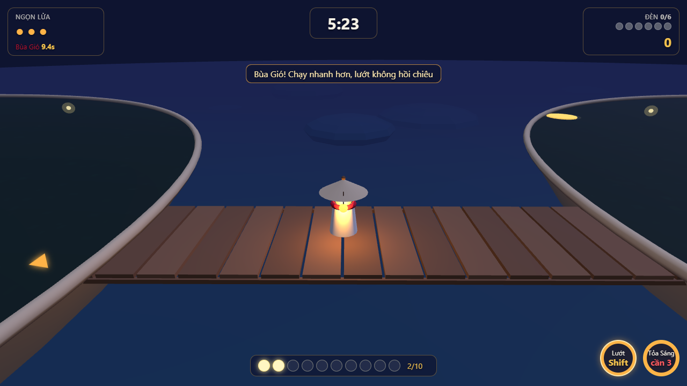
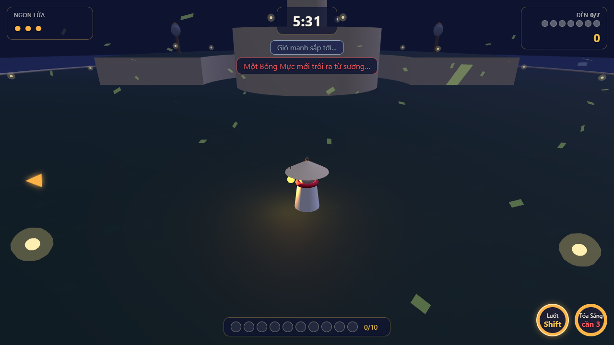

# Đảo Đèn Lồng

> **Video demo (4 phút 20 giây):** [demo.mp4 trong Release v1.0.0](https://github.com/Son0709/K5-L3A-DAY12-LeHoangSon-2A202603662-AI-SDLC-Dao-Den-Long/releases/download/v1.0.0/demo.mp4) (tệp 269 MB, tải về để xem) · [trang Release](https://github.com/Son0709/K5-L3A-DAY12-LeHoangSon-2A202603662-AI-SDLC-Dao-Den-Long/releases/tag/v1.0.0)

Game 3D góc nhìn thứ ba. Mây, người giữ đèn nhỏ tuổi (đội nón lá có treo đèn lồng nhỏ, quàng khăn đỏ), gom đom đóm để giữ sáng các Đèn Lồng Lớn và né Bóng Mực trong sương đen, qua ba đêm: **Đảo Bến**, **Đảo Cau**, **Đảo Chuông**. Đèn hao dầu dần, Bóng Mực hút dầu, và mục tiêu là giữ đảo sáng tới bình minh.

| Đảo Bến | Đảo Cau (Bùa Gió) | Đảo Chuông (gió mạnh) |
|---|---|---|
|  |  |  |

*(Ảnh chụp từ bản build thật bằng Chrome; giao diện hiện tại có thể khác đôi chút.)*

## Trạng thái
- **Xong:** lõi mô phỏng tất định và chế độ headless (Test Contract v1.3), bản 3D cho cả 3 Đêm, bảng xếp hạng lưu đĩa, benchmark, soak test.
- **Chưa làm (ghi trung thực, xem [bằng chứng Phase 4](docs/proof/phase-4/README.md)):** đổi phím, giảm chuyển động, cỡ chữ ≥ 18 px kèm chữ lớn, chỉ báo hình ảnh đầy đủ, thanh dầu trên đèn, chế độ "Bảng màu dễ phân biệt".

## Yêu cầu hệ thống
- **Node.js 22.18 trở lên** (mã TypeScript chạy trực tiếp, không cần biên dịch). Đã chạy trên Node 26 (Windows 11).
- **Trình duyệt hiện đại có WebGL** để chơi (đã thử Chrome). Cần Chrome, Edge hoặc Chromium **có sẵn trên máy** để chạy `bench`.
- Hệ điều hành: phát triển và đo trên **Windows 11**. Phần lõi và test chạy trên Linux (GitHub Actions, Ubuntu) và các test đạt, nhưng **chưa thử trên macOS**; không có phụ thuộc riêng của nền tảng.
- Card đồ họa tích hợp là đủ để chơi; số đo cụ thể ở mục Benchmark.

## Cài đặt và chạy
```
npm install
npm start
```
`npm start` (cũng là `run_cmd`) build game ở lần chạy đầu, phục vụ game cùng bảng xếp hạng tại `http://localhost:5173` và mở trình duyệt. Dùng `--no-open` để không mở trình duyệt, `--port <số>` để đổi cổng.
Để phát triển: `npm run dev`. Bản web tĩnh: `npm run build:web` rồi phục vụ thư mục `dist/` bằng web server tĩnh bất kỳ (khi đó bảng xếp hạng lưu trong trình duyệt thay vì trên đĩa).

## Điều khiển
| Phím | Việc |
|---|---|
| W A S D | Đi lại (theo hướng camera) |
| Space | Nhảy (chỉ khi chạm đất) |
| Shift | Lướt (14 m/s trong 0.2 s, hồi 1.5 s) |
| E | Nạp đom đóm vào đèn gần nhất (thắp đèn, hoặc châm dầu nếu đèn đang sáng; trong 2 m) |
| F | Tỏa sáng: làm choáng và đẩy lùi Bóng Mực trong 5 m (tốn 3 đom đóm, hồi 3 s) |
| Mũi tên trái/phải hoặc kéo chuột | Xoay camera |
| Esc hoặc P | Tạm dừng (Tiếp tục, Chơi lại Đêm, Cài đặt, Về menu) |
| R | Chơi lại Đêm |

Cài đặt (âm lượng, độ nhạy chuột) được lưu. Âm thanh tổng hợp bằng Web Audio, không dùng file âm thanh. **Đổi phím chưa có.**

## Luật chơi
- **Mục tiêu: giữ đảo sáng tới bình minh.** Hết giờ (240/270/300 s) mà Mây còn sống và số đèn đang sáng ≥ 60% tổng (3/5, 4/6, 5/7) thì thắng Đêm đó. Hết Ngọn Lửa, hoặc hết giờ mà thiếu đèn thì thua và chơi lại Đêm đó. Thắng cả 3 Đêm thì đón Bình Minh; điểm tổng là tổng điểm các Đêm đã thắng.
- **Đèn có dầu** (tối đa 100, hao 1 mỗi giây). Thắp lần đầu cần 10 đom đóm, thắp lại chỉ cần 5. Bấm E ở đèn đang sáng để châm dầu (mỗi đom đóm cho 10 dầu).
- **Bóng Mực hút dầu:** đèn dưới 30 dầu mất vùng an toàn 6 m; Bóng Mực tới đèn yếu nhất và hút 5 dầu mỗi giây. Chúng đuổi Mây khi Mây vào tầm 12 m. Chạm vào thì mất 1 ngọn lửa (có 3) và rơi một nửa số đom đóm.
- Sức chứa 10 đom đóm, tăng 2 sau mỗi lần thắp thành công, tối đa 20. Rơi khỏi đảo mất 1 ngọn lửa và toàn bộ đom đóm.
- **Điểm:** +5 mỗi đom đóm nạp, +100 thắp lần đầu, +40 thắp lại, +5 mỗi Bóng Mực trúng Tỏa Sáng (+15 nếu nó đang hút dầu). Thắng ở bình minh: mỗi đèn còn sáng +50 và số dầu còn lại, mỗi ngọn lửa còn lại +50.
- **Đêm 2:** hai đảo nối bằng cầu tre không lan can, bục vàng tung Mây sang đảo kia, Gió Lạc cướp đom đóm, Bùa Gió (chạy 7.2 m/s, lướt không hồi chiêu). **Đêm 3:** ba tầng với vách đứng, dốc, bục nhảy, tháp chuông và gió mạnh mỗi 30 giây.

## Bảng xếp hạng
Sau Bình Minh hoặc sau khi thua ở bất kỳ Đêm nào có thể nhập tên (3–12 ký tự: chữ, số, gạch dưới; hỗ trợ tiếng Việt có dấu) để lưu điểm. Top 10 sắp theo điểm, bằng điểm thì ai đạt trước đứng trên, lưu ở `data/leaderboard.json`, xem từ menu chính. Xuất ra file:
```
node scripts/run.ts --export-leaderboard out.json     # {"entries": [ ... ]}
```

## Kiểm thử
```
npm test                 # 160 unit test: luật, ba bản đồ, nhiên liệu đèn, tất định, CLI, bảng xếp hạng, soak, contract
npm run typecheck
npm run proof            # chạy CLI thật qua 57 tình huống, soak, xuất bảng xếp hạng; sinh docs/proof/phase-4/
npm run screens          # điều khiển bản 3D bằng Chrome thật, chụp ảnh, kiểm tra tạm dừng và lưu cài đặt
npm run e2e:leaderboard  # chơi tới khi thua, lưu điểm, tắt/bật lại máy chủ, xuất bảng xếp hạng
```

## Headless (Test Contract v1.3)
Khai báo ở [game.contract.json](game.contract.json). Logic chạy 60 tick/giây, không cần cửa sổ hay GPU:
```
node src/headless/cli.ts --seed <int> --night <1|2|3> [--scenario f.json] [--inputs f.json] --ticks <int> --out <f.jsonl> [--snapshot-every 10]
```
Mã thoát: 0 bình thường, 2 nếu `--night` không hợp lệ hoặc file scenario/inputs sai định dạng. Cùng seed, scenario và inputs cho output giống hệt nhau. Một Đêm đầy đủ (21.600 tick) chạy dưới 0,4 giây.

## Benchmark
```
node scripts/bench.ts --seed 42 --duration 30 --out bench.json     # hoặc: npm run bench
```
Mở cửa sổ 1280×720 (không toàn màn hình, tắt vsync bằng cờ Chrome), tải cảnh chuẩn (200 Bóng Mực wander, 100 đom đóm, L1–L3 sáng, camera bay vòng), 3 s khởi động rồi đo đúng `--duration` giây. Cần Chrome/Edge/Chromium (đặt `CHROME_PATH` nếu ở chỗ lạ); thêm `--headless` nếu không có màn hình. Nếu cửa sổ ngừng dựng hình, lệnh tự chạy lại ở chế độ headless và ghi rõ vào `bench.json`.

Kết quả đã commit ([bench.json](bench.json)), Core i5-11400H, Intel UHD, **cắm điện**, Chrome 157: **92,7 FPS trung bình** (≥ 60), **1% thấp nhất 30,3** (≥ 30), tải 2,6 s (≤ 10 s). Ba lần đo cho avg 92,4–98,4 và 1% low **29,6–35,2**: chỉ số 1% low sát ngưỡng và có một lần dưới 30 khoảng 0,4. Máy chạy pin bị giảm xung và cho số thấp hơn (`power_source` được ghi trong `bench.json`). Máy chấm khác sẽ cho số khác.

## Soak test
```
node --expose-gc scripts/soak.ts --seed 7 --nights 10 --out soak.json     # hoặc: npm run soak
```
10 Đêm liên tiếp trong một tiến trình (Đêm 1, 2, 3 xoay vòng), Đêm thứ i dùng seed 7 + i (i từ 1), input ngẫu nhiên theo seed. Kết quả ([soak.json](soak.json)): 0 lỗi, bộ nhớ không tăng. **Làm nóng:** trước các Đêm được đo, tiến trình chạy 3 Đêm bỏ đi để bộ biên dịch JIT của V8 ổn định (việc này làm tiến trình tăng vài MB ở mọi chương trình, không phải rò rỉ; trên Linux nó từng đủ để vượt ngưỡng 20%). Để minh bạch, `soak.json` ghi `warmup_nights` và `mem_cold_start_mb` (bộ nhớ lúc nguội); dùng `--warmup 0` để đo nguyên văn lúc nguội.

## Sáng tạo của tôi
Những chi tiết tôi thêm quanh phần lõi (tất cả chỉ ở lớp hiển thị, không đổi đầu ra headless):
- **Lời Ông Đăng** cho từng Đêm (giới thiệu Đêm), viết riêng để dẫn dắt người chơi vào từng bản đồ.
- **Biển mây, cầu tre từng tấm ván, lá bay báo gió trước 2 giây, vòng sáng vùng an toàn** quanh đèn, và đảo sáng dần lên khi thắp đèn.
- **Âm nhạc và hiệu ứng tổng hợp tại chỗ** (Web Audio), không cần file âm thanh.
- **Tên có dấu trong bảng xếp hạng** (ví dụ `Nguyễn_An`), vượt yêu cầu ASCII của ticket.
Bằng chứng ngắn rằng phần cũ vẫn đúng: toàn bộ unit test và `npm run proof` (nhóm hồi quy) vẫn đạt sau các thay đổi này.

## Tài liệu
- Quyết định thiết kế: [ADR-0001](docs/notes/adr-0001-lantern-fuel.md); thay đổi phá vỡ tương thích: [CHANGELOG.md](CHANGELOG.md)
- Spec và giả định: [Phase 2](docs/notes/phase2-spec.md), [Phase 1](docs/notes/assumptions.md)
- Bằng chứng từng phase: [phase-1](docs/proof/phase-1/README.md), [phase-2](docs/proof/phase-2/README.md), [phase-3](docs/proof/phase-3/README.md), [phase-4](docs/proof/phase-4/README.md)
- Nhật ký dùng AI (kèm token): [docs/notes/ai-log.md](docs/notes/ai-log.md); retro: [docs/notes/retro.md](docs/notes/retro.md)
- Quy ước cho agent (harness): [AGENTS.md](AGENTS.md), skill `.claude/skills/verify`, hook `Stop`
- Nguồn và giấy phép: [CREDITS.md](CREDITS.md), [LICENSE](LICENSE) (MIT)
